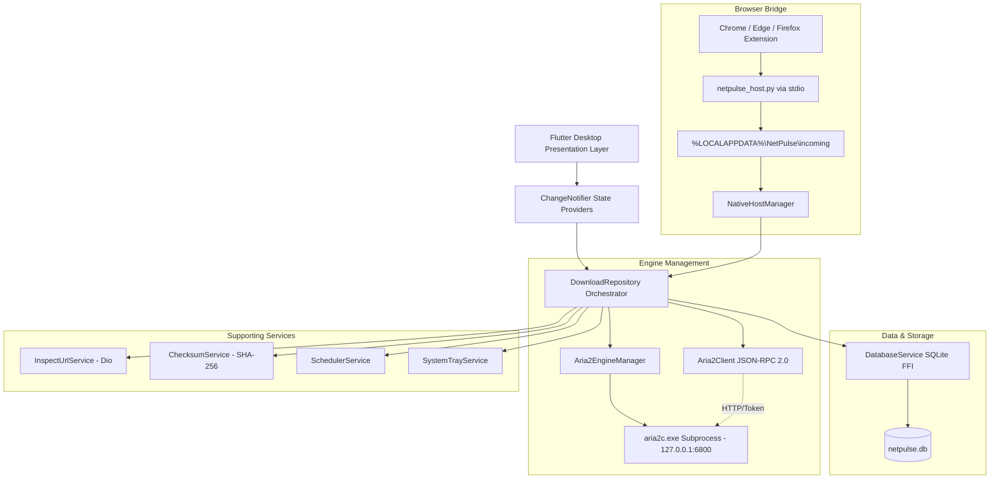

# NetPulse Architecture & Engineering Specification

This document details the architectural design, subsystems, concurrency model, and data flow of **NetPulse**.

---

## 🏛️ High-Level System Architecture

NetPulse is designed following Clean Architecture principles, ensuring modularity, testability, and strict separation between the UI presentation layer, the business domain, the background download engine, and persistent storage.



---

## 🧩 Architectural Subsystems

### 1. Presentation Layer (`lib/features/`, `lib/widgets/`)
- Built with **Flutter Desktop for Windows**.
- Utilizes custom Material 3 widgets with a futuristic visual identity (Deep Navy `#090D16`, Electric Blue `#00E5FF`, Neon Purple `#7C4DFF`).
- **Reactive State Management**: Powered by `provider`. The UI never calls raw SQLite queries or engine RPC directly; it communicates through `DownloadProvider`, `NetworkMonitorProvider`, and `SettingsProvider`.
- **60 FPS Performance Throttling**: Progress polling from the aria2 engine runs every 750ms on a non-blocking background timer. Database writes are batched and throttled to prevent UI hitching.

### 2. aria2 Engine Supervisor (`lib/services/aria2/`)
- **Process Management**: `Aria2EngineManager` locates the bundled `assets/bin/aria2c.exe` or system installation, extracts it to AppData if required, and spawns the background worker with flags:
  ```
  --enable-rpc=true
  --rpc-listen-port=6800
  --rpc-listen-all=false
  --rpc-allow-origin-all=false
  --rpc-secret=<32-char-random-hex>
  --max-connection-per-server=16
  --split=8
  --min-split-size=5M
  --continue=true
  --disk-cache=32M
  --file-allocation=none
  --max-tries=5
  --retry-wait=3
  --quiet=true
  ```
- **Security Boundary**: The RPC server is bound strictly to `127.0.0.1` and never exposed to external network interfaces. All RPC requests require a cryptographically generated token generated at startup.
- **Graceful Lifecycle**: When the NetPulse window is closed, active tasks continue if minimized to tray; on explicit exit, `client.shutdown()` is invoked followed by process termination.

### 3. URL Inspection & Adaptive Acceleration (`lib/features/add_download/inspect_url_service.dart`)
Before committing a download task to aria2:
1. `InspectUrlService` issues a `HEAD` request (or `GET` with `Range: bytes=0-0` fallback) using `Dio`.
2. Inspects headers:
   - `Content-Disposition`: Extracts canonical filename.
   - `Content-Length` & `Content-Range`: Determines file size.
   - `Accept-Ranges`: Verifies whether the server accepts byte ranges.
3. If byte ranges are supported, sets multi-connection segmented downloading (up to 16 threads).
4. If byte ranges are unsupported, automatically sets connection count to 1 to prevent corrupt chunk merges.

### 4. Database Persistence & Reconciliation (`lib/services/database/database_service.dart`)
- NetPulse uses SQLite via `sqflite_common_ffi` on Windows.
- **Reconciliation Algorithm**:
  During startup, `_reconcileUnfinishedDownloads()` queries SQLite for tasks in `active` or `waiting` status.
  For each task, it re-adds the URI to aria2 with `--continue=true` and updates the GID in SQLite, guaranteeing that downloads survive sudden power loss or application restarts.

### 5. Native Messaging Browser Bridge (`lib/services/browser_bridge/`, `browser_extension/`)
- Communicates via standard WebExtensions Native Messaging.
- Chrome and Firefox extensions send download metadata to `netpulse_host.py` via standard input.
- `netpulse_host.py` writes task envelopes to `%LOCALAPPDATA%\NetPulse\incoming\task_*.json`.
- `NativeHostManager` monitors this directory and ingests tasks instantly, triggering desktop notifications and starting downloads.

---

## 🔒 Security Architecture

1. **Path Traversal Prevention**: `FileUtils.sanitizeFilename()` removes directory traversal elements (`../`, `..\\`), null bytes, and Windows illegal characters (`< > : " / \ | ? *`).
2. **Execution Gate**: Executable extensions (`.exe`, `.msi`, `.bat`, `.cmd`, `.ps1`, `.scr`) trigger a mandatory warning dialog requiring user confirmation before opening. Downloaded files are never executed automatically.
3. **RPC Protection**: The RPC interface communicates exclusively over loopback sockets with an ephemeral secret key.

